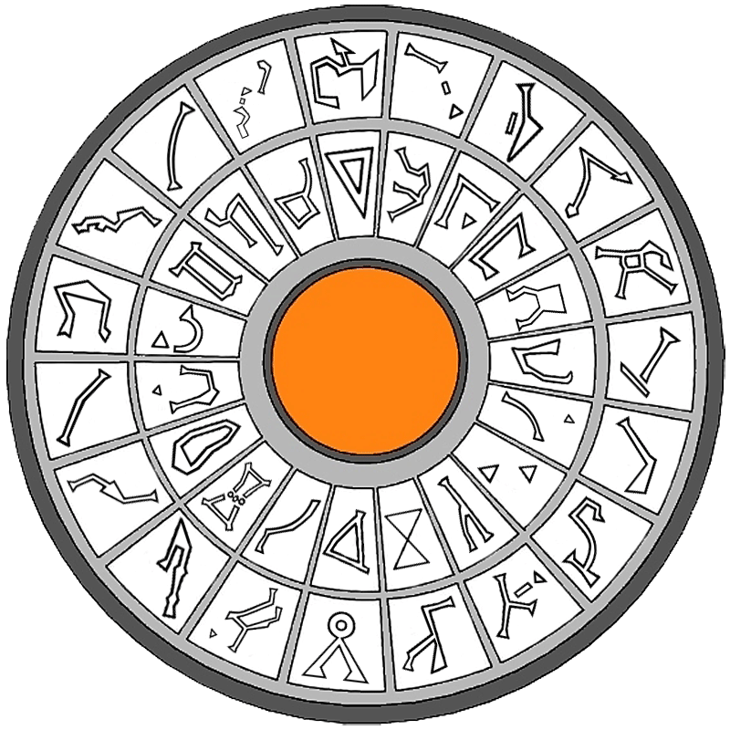
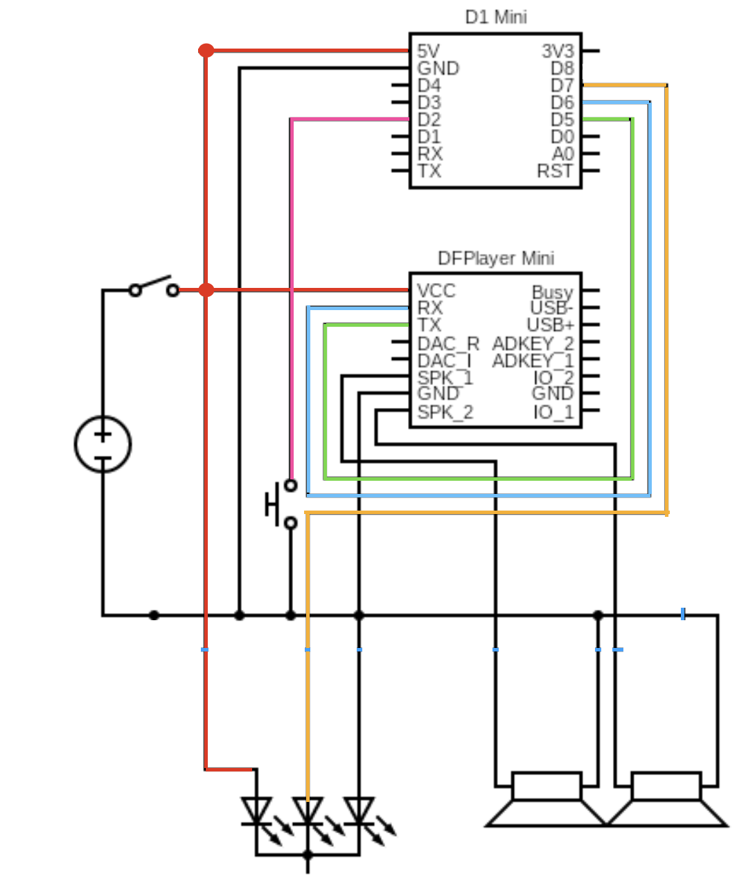
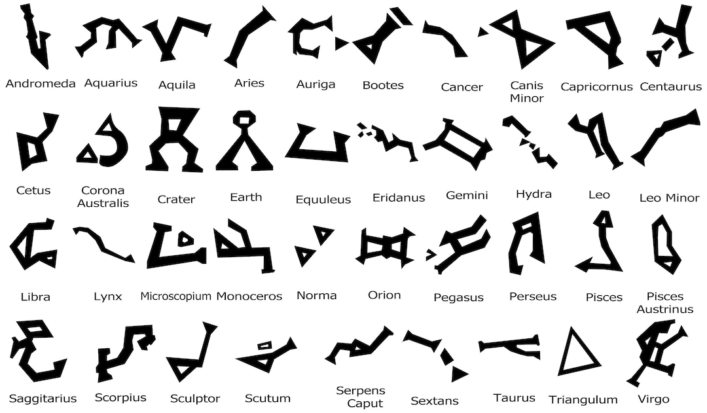

# Stargate Dial Home Device (DHD)
Arduino code used to build the DHD lights and sounds for a 3D build.

The DHD's layout groups the 38 universal Milky Way address glyphs into an outer ring and an inner ring.
• Outer Ring (20 Glyphs): Contains the first 20 constellation markers.
• Inner Ring (18 Glyphs): Contains the remaining 18 constellation markers.
• Central Button: The red dome used to engage the wormhole after dialing.

While the standard Stargate has 39 symbols (38 constellations + 1 unique Point of Origin), a standard off-world DHD only maps the 38 universal constellations. The 39th slot on any local DHD automatically maps to that specific planet's unique local Point of Origin symbol.

The DHD code has many mode controlled by a menu button or a webpage (press multiple time to select the menu)
- menu 1: randomly select 7 keys and light them up, the central button is also on. In this mode you can keep the DHD on
- menu 2: select the earth adress the central button is also on. In this mode you can keep the DHD on
- menu 3: play a sequence of selecting 7 random keys with sound effects

**WORK IN PROGRESS**

## 3D Printing
https://makerworld.com/en/models/1850967-stargate-dhd-large 

## Bill of Materials

- LEDs https://de.aliexpress.com/item/1005006335228821.html (the one I used)
- NodeMcu Mini D1
- DFPlayer Mini MP3 Player
- Speaker(s)

## Wiring

## Programming
edit dhd.ino and set WIFI SSID and password

in the code verify that each symbols is properly mapped

## Links
- https://stargate.fandom.com/wiki/Dial_Home_Device