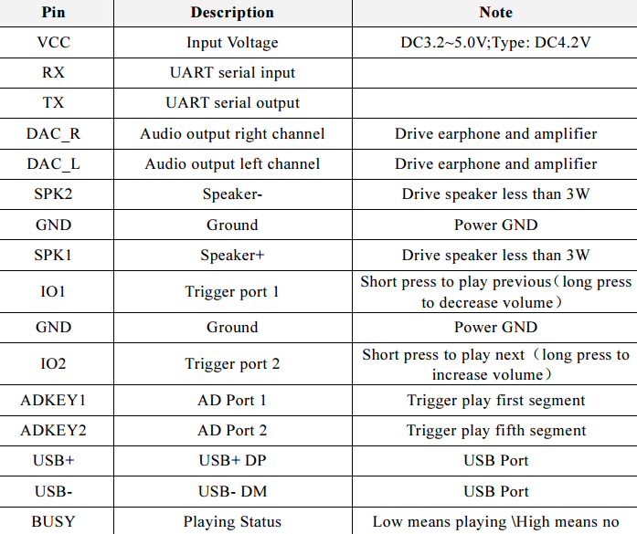
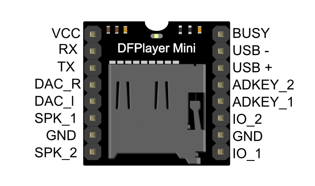
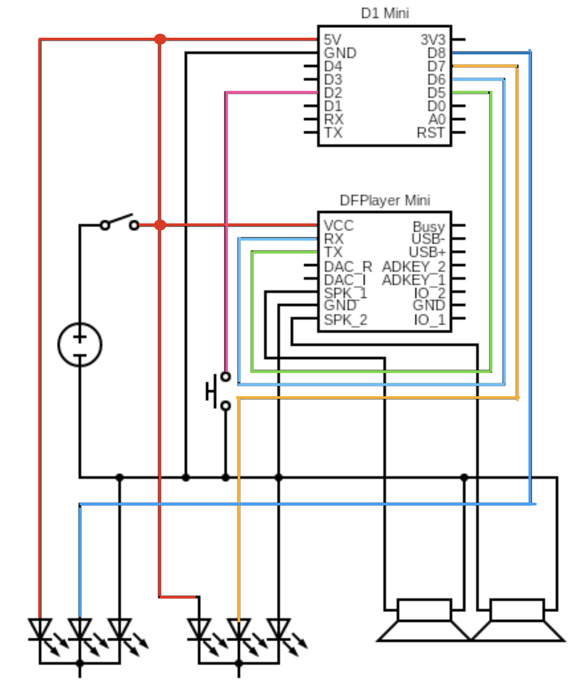
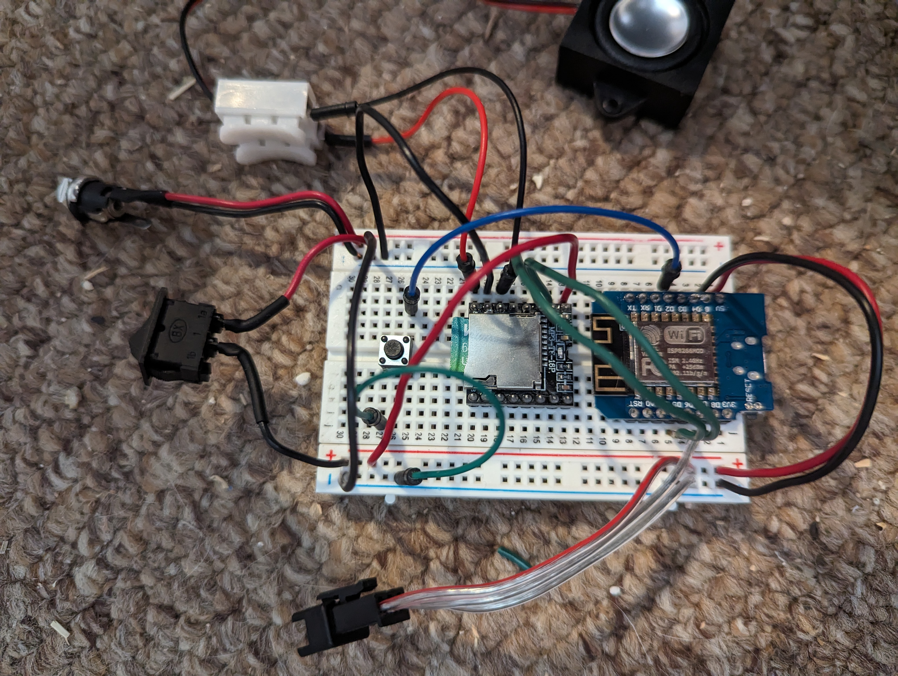
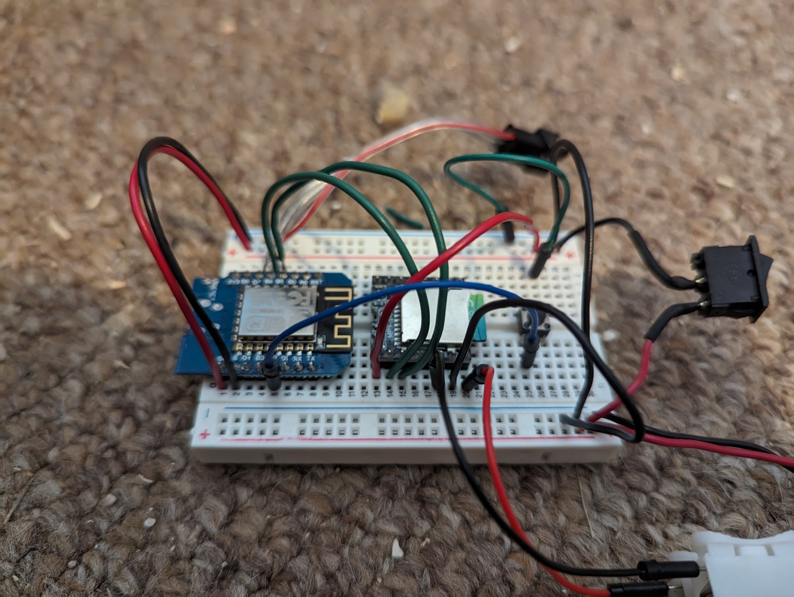
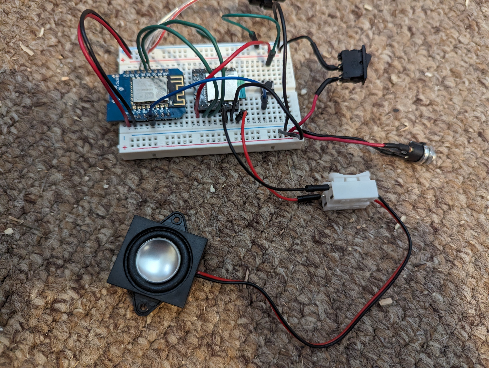
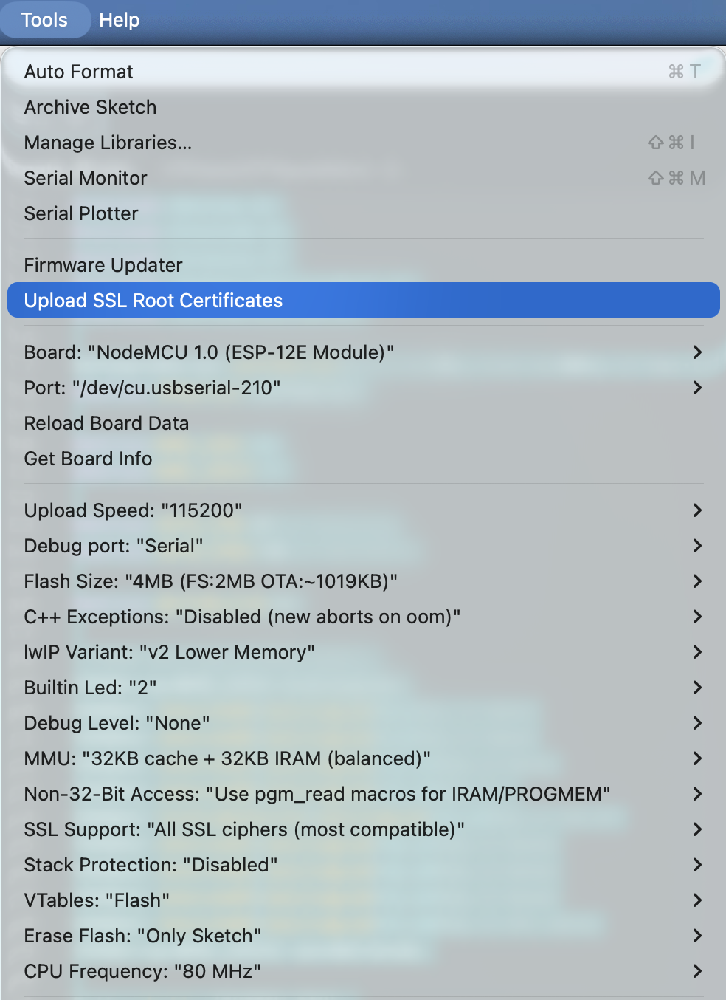
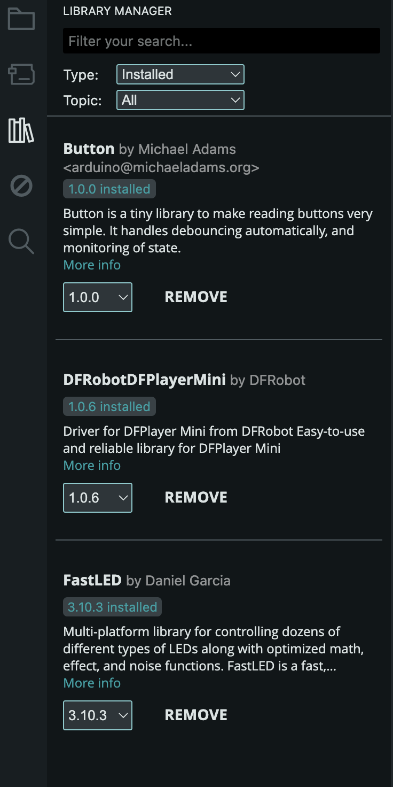

# Stargate gate
Arduino code used to build the Stargate lights and sounds for a 3D build controlled by a button or a webserver

## 3D Printing

I recommend you to use
https://makerworld.com/en/models/577364-3ft-stargate-with-electronics 


Original 3D model files can be found here: 
https://www.printables.com/model/560402-stargate-with-iris-80cm-in-diameter

Altered files, to allow easier placement of the LED strings, can be found here: 
https://www.printables.com/model/688291-stargate-modified-chevron-parts

## Bill of Materials

- LEDs https://de.aliexpress.com/item/1005006335228821.html (the one I used)
- NodeMcu Mini D1
- DFPlayer Mini MP3 Player
- Speaker(s)


### NodeMcu Mini D1

The Arduino hardware used is the NodeMcu Mini D1. It's a WiFi enabled board, which is far more powerful than this build required. But it's small and was in my parts bin to use. It also allows future upgrades to use the WiFi option for IoT control, if desired.

### DFPlayer Mini MP3 Player

The DFPlayer Mini MP3 Player For Arduino is a small and low cost MP3 module with an simplified output directly to the speaker. The module can be used as a stand alone module with attached battery, speaker and push buttons or used in combination with microcontrollers such as Arduino, ESP32, Raspberry Pi and any microcontrollers with Uart.

 

#### Specification

* Sampling rates (kHz): 8/11.025/12/16/22.05/24/32/44.1/48
* 24 -bit DAC output, support for dynamic range 90dB , SNR support 85dB
* Fully supports FAT16 , FAT32 file system, maximum support 32G of the TF card, support 32G of U disk, 64M bytes NORFLASH
* A variety of control modes, I/O control mode, serial mode, AD button control mode
advertising sound waiting function, the music can be suspended. when advertising is over in the music continue to play
* audio data sorted by folder, supports up to 100 folders, every folder can hold up to 255 songs
* 30 level adjustable volume, 6 -level EQ adjustable
* Working voltage: DC3.2~5V
* Size: 20mm*20mm
* Weight: 20g

The MP3 player is the DFPlayer Mini module, which you can get from many places. It requires a MicroSD card. 

### Speaker(s)

I only used one speaker, but the module can support two for stereo sound if desired. These have been the best speakers that don't sound tinny when used: 
https://www.amazon.com/gp/product/B0BTP67F81

### Push button

The button to activate the lights and sounds can be any momentary tactile button switch. I used a 6x6x5mm momentary tactile button switch.

### Power Supply
You can use a 5V plug-in adapter and power jack wired to the arduino and MP3 module. It was important to make sure the MP3 module had the shortest wiring to the power supply as possible, and not pulling power directly from the Arduino.

You can also power everything using the USB-C port of the NodeMcu Mini D1.

## Wiring



DFPlayer Mini wiring as reference


  

## Mouting LED onto the stargate

## Prepare SDCard

Files must be named in a specific way and uploaded in the order you intend to reference them in code, or it won't work correctly.

Format a micro sdcard as FAT32 (use rapsberry pi imager is the easiest), no partition! no SDcard bigger than 16GB

### For Mac User

NOTE: If you are using Mac OS X to copy the mp3, the file system will automatically add hidden files like: "._0001.mp3" for index, which this module will handle as valid mp3 files. It is really annoying. So you can run following command in terminal to eliminate those files.

```dot_clean /Volumes/<SDVolumeName>```
Please replace the to the volume name of your SD card.

Copy the file 0001.mp3 onto it, unmount and insert into the player

## Installing tools

Install Arduino IDE

Open the stargate.ino file 

Set WIFI SSID and paswsord

Choose your board



Install these libraries




if you get this error:
```
Compilation error: fork/exec /Users/xxxxxx/Library/Arduino15/packages/esp8266/tools/python3/3.7.2-post1/python3: bad CPU type in executable
```
You may need to install rosetta again on latest macos as Arduino IDE relly on x86 python compiler code.
Installing Apple's Intel translation environment will allow the IDE to run the necessary ESP8266 compiler tools seamlessly
```
softwareupdate --install-rosetta --agree-to-license
```

You only have to change the value of the LED in that file depending how you mounted them physically inside the gate. Change one variable at a time till one chevron (3 consecutive leds) is properly lighted on

```
CRGBSet chevron05(dialingLed(0, 2));        //  this mean led 0, 1 and 2
CRGBSet chevron06(dialingLed(6, 8));        
CRGBSet chevron07(dialingLed(12, 14));      
CRGBSet chevron08(dialingLed(18, 20));      
CRGBSet lockingChevron(dialingLed(25, 29)); 
CRGBSet chevron01(dialingLed(30, 32));      
CRGBSet chevron02(dialingLed(36, 38));     
CRGBSet chevron03(dialingLed(42, 44));      
CRGBSet chevron04(dialingLed(47, 49));      
```

Upload code and push button once or go to demo mode to see all chevron illuminated and fix values above till the result is perfect.

The pin numbers in the Stargate.ino will indicate what wires were used for the button (D2), LEDs (D7 for Chevrons, D8 for wormhole glow), and MP3 (D5 and D6) connections. 

## Debug

WIP


## Get other mp3

Read https://done.land/components/audio/playback/dfplayermini/preparesdcard/ on how to ensure the new mp3 is in a vlid format.

- https://www.101soundboards.com/boards/33269-stargate-sg1-soundboard
- https://universal-soundbank.com/en/stargate-sg1.htm

## Code improvment
- https://wiki.dfrobot.com/dfplayer_mini_sku_dfr0299#For%20Mac%20User